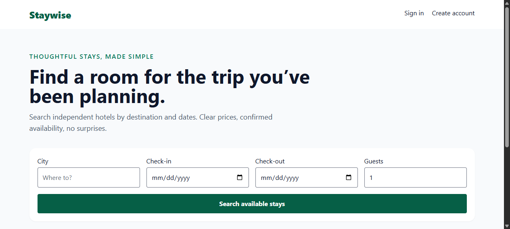

# Staywise — Hotel Booking

Repository: https://github.com/0xyz-exe/hotel-booking-laravel

## Screenshots

### Room Availability & Filter Search


### Guest Reservations Dashboard


### Guest Authentication & Access


## Features

- **Real-Time Room Search:** Filter rooms by destination city, guest capacity, and check-in / check-out dates.
- **Concurrency & Overlap Control:** Automatic exclusion of rooms with conflicting active bookings using transactional inventory locks.
- **Guest Booking Workflow:** Authenticated reservations with autogenerated unique booking references (e.g. `HB-XXXXXXXX`).
- **Self-Service Cancellation:** Guests can cancel unfulfilled reservations prior to check-in date.
- **Integer Minor-Unit Pricing:** Server-side nightly rate calculation in integer cents to prevent floating-point rounding errors.

## Requirements
PHP 8.3+, Composer, Node.js/npm. Default setup uses SQLite; configure PostgreSQL via `.env` if needed.

## Setup (PowerShell)
```powershell
Copy-Item .env.example .env
php artisan key:generate
New-Item -ItemType File -Force database/database.sqlite
php artisan migrate --seed
npm install
npm run build
php artisan serve
```
Register at `/register`. Search at `/`; reservations at `/bookings`.

## Tests
`php artisan test`

## Reservation rules
Check-in inclusive, check-out exclusive. Inventory checked in a transaction after locking the room row; overlapping pending/confirmed reservations count against inventory. Prices use integer minor units and are calculated server-side. Unique booking references. Guests access and cancel only their own bookings. Cancellation permitted before check-in.

## Limitations / deployment
Demo inventory seeded locally. No payment processing, email confirmation, hotel-owner admin UI, image uploads, seasonal rates, or configurable cancellation policy. Add authorized hotel/room management before production. Configure secrets, HTTPS, backups, and mail before deployment. Not deployed. GitHub publication pending.

<p align="center">
<a href="https://github.com/laravel/framework/actions"></a>
<a href="https://packagist.org/packages/laravel/framework"></a>
<a href="https://packagist.org/packages/laravel/framework"></a>
<a href="https://packagist.org/packages/laravel/framework"></a>
</p>

## About Laravel

Laravel is a web application framework with expressive, elegant syntax. We believe development must be an enjoyable and creative experience to be truly fulfilling. Laravel takes the pain out of development by easing common tasks used in many web projects, such as:

- [Simple, fast routing engine](https://laravel.com/docs/routing).
- [Powerful dependency injection container](https://laravel.com/docs/container).
- Multiple back-ends for [session](https://laravel.com/docs/session) and [cache](https://laravel.com/docs/cache) storage.
- Expressive, intuitive [database ORM](https://laravel.com/docs/eloquent).
- Database agnostic [schema migrations](https://laravel.com/docs/migrations).
- [Robust background job processing](https://laravel.com/docs/queues).
- [Real-time event broadcasting](https://laravel.com/docs/broadcasting).

Laravel is accessible, powerful, and provides tools required for large, robust applications.

## Learning Laravel

Laravel has the most extensive and thorough [documentation](https://laravel.com/docs) and video tutorial library of all modern web application frameworks, making it a breeze to get started with the framework.

In addition, [Laracasts](https://laracasts.com) contains thousands of video tutorials on a range of topics including Laravel, modern PHP, unit testing, and JavaScript. Boost your skills by digging into our comprehensive video library.

You can also watch bite-sized lessons with real-world projects on [Laravel Learn](https://laravel.com/learn), where you will be guided through building a Laravel application from scratch while learning PHP fundamentals.

## Agentic Development

Laravel's predictable structure and conventions make it ideal for AI coding agents like Claude Code, Cursor, and GitHub Copilot. Install [Laravel Boost](https://laravel.com/docs/ai) to supercharge your AI workflow:

```bash
composer require laravel/boost --dev

php artisan boost:install
```

Boost provides your agent 15+ tools and skills that help agents build Laravel applications while following best practices.

## Contributing

Thank you for considering contributing to the Laravel framework! The contribution guide can be found in the [Laravel documentation](https://laravel.com/docs/contributions).

## Code of Conduct

In order to ensure that the Laravel community is welcoming to all, please review and abide by the [Code of Conduct](https://laravel.com/docs/contributions#code-of-conduct).

## Security Vulnerabilities

If you discover a security vulnerability within Laravel, please send an e-mail to Taylor Otwell via [taylor@laravel.com](mailto:taylor@laravel.com). All security vulnerabilities will be promptly addressed.

## License

The Laravel framework is open-sourced software licensed under the [MIT license](https://opensource.org/licenses/MIT).
